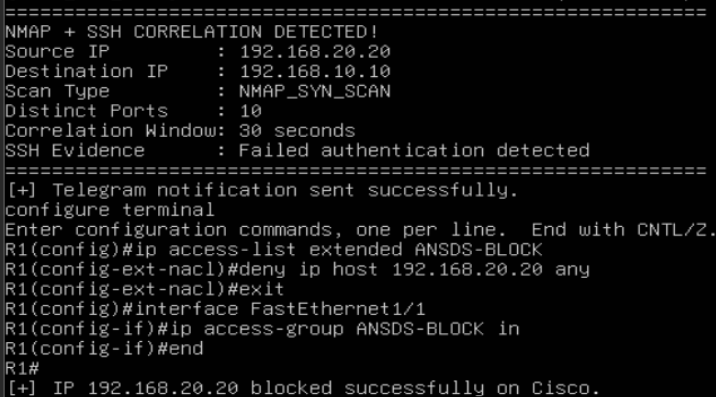
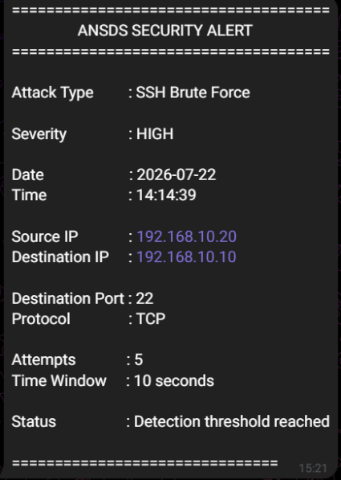

# Automated Network Self-Defense System (ANSDS)

> Detect, correlate, alert and automatically contain network threats: from raw packets to a temporary ACL block on a Cisco router.

ANSDS is a network detection-and-response prototype developed during a summer internship (July 1 - August 31, 2026) at the **Agence Nationale de la Cybersécurité (ANCS)**, Tunisia. It captures traffic with Scapy, detects SSH brute-force attempts and Nmap scans, correlates indicators to confirm an incident, notifies the administrator on Telegram, and automatically applies (then removes) a blocking ACL on a Cisco IOS router through Netmiko.

Everything was built and validated in a controlled **GNS3** lab.

---

## Key Features

| Capability | How it works |
| --- | --- |
| **SSH brute-force detection** | TCP SYN packets to port 22 counted per source IP over a **10-second sliding window** (threshold: 5) |
| **Nmap scan detection** | TCP flag signatures for **SYN, FIN, NULL and Xmas** scans, plus distinct destination ports in a **2-second window** (threshold: 10) |
| **Event correlation** | A Nmap scan is correlated with failed SSH authentication evidence within a **30-second window** before the response is triggered |
| **False-positive reduction** | Decisions rely on source behavior (ports, repetition, timing), not on a single packet. Legitimate traffic was tested separately |
| **Alerting** | Structured Telegram alert (attack type, severity, source/destination IP, port, protocol, attempts, time window), sent once per incident to avoid alert fatigue (`count == THRESHOLD`) |
| **Automated containment** | Dynamic extended ACL `ANSDS-BLOCK` (`deny ip host <SOURCE_IP> any`) applied on the router interface via Netmiko |
| **Temporary blocking** | The block expires automatically (60 s in the lab) and the ACL is removed, restoring the initial state |
| **Resilience** | `try / except / finally` around all router operations (timeout and authentication errors handled, SSH session always closed) |
| **Traceability** | Event log: `NMAP_DETECTED`, `SSH_CORRELATION_CONFIRMED`, `TELEGRAM_ALERT_SENT`, `IP_BLOCKED`, `TEMPORARY_BLOCK_SCHEDULED`, `TEMPORARY_BLOCK_EXPIRED`, `IP_UNBLOCKED` |

---

## Architecture

```
Attacker
   |
   v
Scapy packet capture
   |
   v
Detection engine --- SSH brute-force detection
   |             \-- Nmap scan detection (SYN / FIN / NULL / Xmas)
   v
SSH correlation  ->  security decision
   |
   +--> Telegram alert (administrator)
   |
   +--> Netmiko --> Cisco router --> dynamic ACL --> temporary block
                                                          |
                                                          v
                                                  automatic unblock
```

Each component has a single responsibility (detection, notification, response, logging), so any module can evolve without touching the others.

---

## Lab Environment (GNS3)

| Device | Role | Address |
| --- | --- | --- |
| Cisco 7200 router (IOS 15.0) | Gateway, NAT (PAT), ACL enforcement | 192.168.10.1/24 |
| Ubuntu Server 24.04 | Victim, runs OpenSSH and the ANSDS engine | 192.168.10.10/24 |
| Kali Linux | Attacker (SSH attempts, Nmap scans) | 192.168.10.20/24 |
| 2 switches + NAT node | Connectivity and Internet access | - |

---

## Repository Structure

```
.
├── Docs/
├── GNS3/ANSDS-Lab/              # GNS3 project
├── Presentation/
├── Report/                      # LaTeX sources of the internship report
├── Scripts/
│   ├── Cisco/cisco_acl_manager.py       # Netmiko: block_ip(), remove_acl()
│   ├── Detection/ssh_detector.py        # SSH brute-force detection
│   ├── Detection/nmap_detector.py       # Nmap scans + SSH correlation
│   ├── Logging/ansds_logger.py          # Event logging
│   └── Telegram/telegram_notifier.py    # send_notification()
├── Docs/sample-ansds.log        # Sample event log from a lab run
├── ANSDS_Report.pdf             # Full internship report (French)
├── .env.example                 # Configuration template
├── requirements.txt
└── README.md
```

---

## Getting Started

### Prerequisites

- Python 3.12, Linux host with packet-capture privileges (root)
- A Cisco IOS router reachable over SSH
- A Telegram bot (created with BotFather) and your chat ID

### Installation

```bash
git clone https://github.com/Imen-y/Automated-Network-Self-Defense-System.git
cd Automated-Network-Self-Defense-System
python3 -m venv venv
source venv/bin/activate
pip install -r requirements.txt
cp .env.example .env      # then fill in your own values
```

### Configuration

Credentials are never stored in the code. Fill in `.env` (ignored by Git):

```
TELEGRAM_BOT_TOKEN=YOUR_BOT_TOKEN
TELEGRAM_CHAT_ID=YOUR_CHAT_ID
ROUTER_HOST=192.168.10.1
ROUTER_USERNAME=ansds
ROUTER_PASSWORD=YOUR_ROUTER_PASSWORD
```

### Run

```bash
sudo ./venv/bin/python Scripts/Detection/ssh_detector.py     # SSH brute-force detection
sudo ./venv/bin/python Scripts/Detection/nmap_detector.py    # Nmap detection + correlation
```

### Test it (lab only)

From the attacker machine, against your own lab target:

```bash
for i in {1..15}; do nc -z <TARGET_IP> 22; done   # triggers the SSH threshold
nmap -sS <TARGET_IP>                              # SYN scan detection
```

---

## Validation Results

All scenarios were executed in the GNS3 lab:

- SSH brute-force alert after 5 SYN packets in 10 s
- Detection of Nmap **SYN, FIN, NULL and Xmas** scans
- Legitimate traffic not flagged as a scan
- Nmap + SSH correlation confirmed, then Telegram alert sent
- Dynamic ACL applied on the router, then removed automatically after expiry
- Authentication failure handled without crashing the engine

Screenshots are available in the full report (`ANSDS_Report.pdf`).





---

## Detection Mapping (MITRE ATT&CK)

| Behavior | Technique |
| --- | --- |
| Nmap SYN / FIN / NULL / Xmas scans | T1046 - Network Service Discovery |
| SSH repeated connection attempts | T1110 - Brute Force |

---

## Limitations

- Validated only in a controlled GNS3 lab, not in production.
- Thresholds and time windows are tuned for the studied scenarios and need adaptation elsewhere.
- Coverage is limited to SSH attempts and the four Nmap scan types.
- The response module targets Cisco IOS devices.

## Roadmap

- Wider detection coverage (new signatures and attack scenarios)
- Risk scoring with severity-based responses
- Supervision dashboard (events, blocked IPs, history)
- SIEM integration for centralized analysis

---

## Disclaimer

This project is for **educational and defensive purposes only**. Run the attack scenarios exclusively on systems you own or are explicitly authorized to test.

## Author

**Imen Yahya** - Computer Science, ISSAT Gafsa (Université de Gafsa)
Internship supervisor at ANCS: M. Wajdi Bengayed
